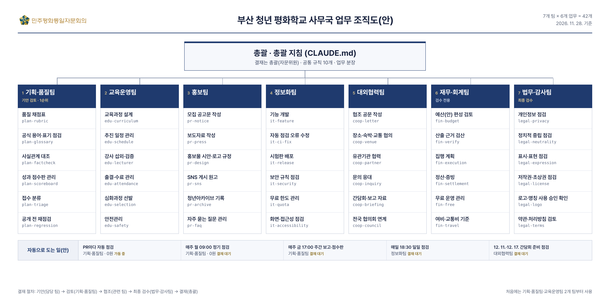

# 평화학교 사무국 업무 체계 (7개 팀 · 42개 업무)

총괄 지침 하나 아래 7개 팀이 결재 절차에 따라 산출물을 기안·검토하는 내부 업무 체계임. Claude Code 안에서 서브에이전트·스킬로 동작하며 추가 비용(유료 API·유료 플러그인) 없음.

## 1. 구성

- 총괄: 결재권자(사용자). 기준은 `CLAUDE.md`의 공통 규칙 10개
- 처음에는 기획·품질팀과 교육운영팀 2개 팀부터 쓰고 필요한 팀을 차례로 추가

| 팀 | 서브에이전트 | 소관 | 업무 명령(6개) |
|---|---|---|---|
| 1. 기획·품질팀 | `quality-team` | 결재 경로의 첫 단계(기안 검토)와 공개 전 최종 재점검, 성과 점수판 | `/plan-rubric` `/plan-glossary` `/plan-factcheck` `/plan-scoreboard` `/plan-triage` `/plan-regression` |
| 2. 교육운영팀 | `education-team` | 기본과정(5회·회당 약 2시간), 심화과정(2박3일·정원 제한), 강사, 출결·수료, 안전 | `/edu-curriculum` `/edu-schedule` `/edu-lecturer` `/edu-attendance` `/edu-selection` `/edu-safety` |
| 3. 홍보팀 | `publicity-team` | 대외 공개 문안 전반, 홍보물 시안, 공식 로고·색상 규정, SNS, 청년아카이브(기록·공개 소통) | `/pr-notice` `/pr-press` `/pr-design` `/pr-sns` `/pr-archive` `/pr-faq` |
| 4. 정보화팀 | `it-team` | www/, android/, ios/, firestore.rules, 빌드·배포 스크립트, 누리집 코드 | `/it-feature` `/it-ci-fix` `/it-release` `/it-security` `/it-quota` `/it-accessibility` |
| 5. 대외협력팀 | `cooperation-team` | 협조 공문, 유관기관 협력, 장소·숙박·교통, 참가자·기관 문의, 간담회·보고 자료, 전국 협의회 연계 | `/coop-letter` `/coop-venue` `/coop-partner` `/coop-inquiry` `/coop-briefing` `/coop-council` |
| 6. 재무·회계팀 | `finance-team` | 예산(안), 산출 근거, 재원 구분, 집행·정산 계획, 여비·교통비 기준, 앱·도구 비용 | `/fin-budget` `/fin-verify` `/fin-execution` `/fin-settlement` `/fin-free` `/fin-travel` |
| 7. 법무·감사팀 | `legal-team` | 개인정보 처리, 이용약관·처리방침(www/js/legal.js), 저작권·초상권, 정치적 중립, 표시 표현, 기관 로고·명칭 사용 승인 | `/legal-privacy` `/legal-neutrality` `/legal-expression` `/legal-license` `/legal-logo` `/legal-terms` |

재무·회계팀과 법무·감사팀은 검수 전용으로 파일을 고치지 않음. 기획·품질팀은 결재 경로의 첫 단계, 법무·감사팀은 마지막 단계임.

## 2. 결재 절차

기안(담당 팀) → 검토(기획·품질팀) → 협조(관련 팀) → 최종 검수(법무·감사팀) → 결재(총괄)

| 산출물 | 결재 경로 |
|---|---|
| 계획안 | 기획·품질 → 교육운영 → 재무·회계 → 대외협력 → 법무·감사 |
| 예산 | 기획·품질 → 재무·회계 → 법무·감사 |
| 홍보물 | 기획·품질 → 홍보 → 교육운영 → 법무·감사 |
| 공문 | 기획·품질 → 대외협력 → 법무·감사 |
| 누리집 | 기획·품질 → 정보화 → 홍보 → 법무·감사 |
| 앱 | 기획·품질 → 정보화 → 교육운영 → 법무·감사 |

각 팀은 1차 전수 검사 → 2차 교차 검사 순서로 보고, 모든 판정에 파일:줄 근거를 붙여 6개 항목 체크표를 채움. 결재 검토 보고서는 `reports/`에, 점수는 `scoreboard.md`에 누적함.

## 3. 사용법 (Claude Code에서)

| 하고 싶은 일 | 입력 |
|---|---|
| 기존 산출물 결재 검토 | `/dept-review 운영계획(안).docx` |
| 새 산출물 기안 (6단계) | `/dept-produce 심화과정 모집 공고문` |
| 개별 업무 하나만 | `/fin-verify 운영계획(안).docx`, `/coop-letter 유엔기념공원 단체 관람 협조` |
| 자동 점검만 (비용 0) | `python3 scripts/dept_check.py [경로] [--format md] [--style official]` |
| .docx 본문 보기 | `python3 scripts/dept_check.py --dump 파일.docx` |

## 4. 팀별 업무 42개

### 기획·품질팀

| 업무 | 명령 | 내용 | 합격선 |
|---|---|---|---|
| 품질 채점표 | `/plan-rubric` | 산출물을 100점 기준으로 채점 | 90점 이상 |
| 공식 용어·표기 점검 | `/plan-glossary` | 기관명·사업명·직함·날짜·금액 표기를 공식 기준에 맞춤 | 표기 위반 0건 |
| 사실관계 대조 | `/plan-factcheck` | 일정·정원·금액을 기준 자료와 한 줄씩 대조 | 불일치 0건 |
| 성과 점수판 관리 | `/plan-scoreboard` | 결재 보고서의 점수와 지적 건수를 누적 기록 | 누락 0건 |
| 접수 분류 | `/plan-triage` | 오류 제보·문의·요청을 담당 팀과 처리 기한으로 분류 | 미분류 0건 |
| 공개 전 재점검 | `/plan-regression` | 공개·배포·제출 직전에 이전 지적 사항의 재발 여부 확인 | 미조치 상 등급 0건 |

### 교육운영팀

| 업무 | 명령 | 내용 | 합격선 |
|---|---|---|---|
| 교육과정 설계 | `/edu-curriculum` | 기본·심화과정 구성을 지침에 맞게 설계·검토 | 지침 요건 누락 0건 |
| 추진 일정 관리 | `/edu-schedule` | 준비부터 결과 보고까지 역산 일정과 요일 검증 | 날짜·요일 오류 0건 |
| 강사 섭외·검증 | `/edu-lecturer` | 강사 후보 선정, 정치적 편향 검증, 대체 강사 확보 | 검증 미완료 강사 0명 |
| 출결·수료 관리 | `/edu-attendance` | 앱 QR 출석 기록 확인과 수료 판정 | 집계 불일치 0건 |
| 심화과정 선발 | `/edu-selection` | 지원서 심사 기준 적용과 정원 내 선발 | 정원 초과 0건 |
| 안전관리 | `/edu-safety` | 현장교육·심화과정 안전 계획과 사고 대응 | 필수 항목 누락 0건 |

### 홍보팀

| 업무 | 명령 | 내용 | 합격선 |
|---|---|---|---|
| 모집 공고문 작성 | `/pr-notice` | 기본·심화과정 모집 공고문 작성·검토 | 핵심 6요소 누락 0건 |
| 보도자료 작성 | `/pr-press` | 행사 전후 보도자료 작성 | 육하원칙 누락 0건 |
| 홍보물 시안·로고 규정 | `/pr-design` | 포스터·현수막·카드뉴스 시안과 공식 로고 사용 점검 | 로고 변형 0건 |
| SNS 게시 원고 | `/pr-sns` | 인스타그램 등 SNS 게시 원고 작성 | 정치 관련 표현 0건 |
| 청년아카이브 기록 | `/pr-archive` | 행사 후 청년아카이브(youtharchive.kr) 기록물 작성 | 기록 항목 누락 0건 |
| 자주 묻는 질문 관리 | `/pr-faq` | 참가자 문의를 바탕으로 FAQ와 앱 도우미 답변 원고 갱신 | 사실 불일치 0건 |

### 정보화팀

| 업무 | 명령 | 내용 | 합격선 |
|---|---|---|---|
| 기능 개발 | `/it-feature` | 앱·누리집 기능을 설계·구현하고 시험 | 시험 실패 0건 |
| 자동 점검 오류 수정 | `/it-ci-fix` | GitHub Actions 실패 원인을 찾아 수정 | 자동 점검 통과 |
| 시험판 배포 | `/it-release` | 웹·안드로이드 APK·iOS TestFlight 시험판 배포 점검 | 미조치 상 등급 0건 |
| 보안 규칙 점검 | `/it-security` | Firestore 보안 규칙과 비밀값 관리 점검 | 규칙 완화·비밀값 0건 |
| 무료 한도 관리 | `/it-quota` | Firebase Spark·GitHub 무료 범위 안에서 운영되는지 점검 | 유료 의존 0건 |
| 화면·접근성 점검 | `/it-accessibility` | 앱·누리집 화면 구성과 웹 접근성 점검 | 대비 미달·alt 누락 0건 |

### 대외협력팀

| 업무 | 명령 | 내용 | 합격선 |
|---|---|---|---|
| 협조 공문 작성 | `/coop-letter` | 유관기관 협조 요청 공문 초안 작성 | 형식 누락 0건 |
| 장소·숙박·교통 협의 | `/coop-venue` | 교육 장소, 심화과정 숙소, 이동 수단 확보 계획 | 확인 필요 항목 표시 누락 0건 |
| 유관기관 협력 | `/coop-partner` | 현장교육 방문지·대학·지자체 협력 사항 정리 | 미확정 기관 공개 0건 |
| 문의 응대 | `/coop-inquiry` | 참가자·기관 문의에 대한 답변 초안 작성 | 기한 초과 0건 |
| 간담회·보고 자료 | `/coop-briefing` | 사무처장 간담회 등 보고 자료와 예상 질의응답 작성 | 미확인 수치 단정 0건 |
| 전국 협의회 연계 | `/coop-council` | 전국 지역회의·협의회 참가 안내와 협조 체계 | 미확인 명단 사용 0건 |

### 재무·회계팀

| 업무 | 명령 | 내용 | 합격선 |
|---|---|---|---|
| 예산(안) 편성 검토 | `/fin-budget` | 항목별 예산(안)이 지침과 집행 기준에 맞는지 검토 | 근거 누락 0건 |
| 산출 근거 검산 | `/fin-verify` | 표의 산출 근거·소계·합계를 직접 다시 계산 | 불일치 0건 |
| 집행 계획 | `/fin-execution` | 월별 집행 계획과 예비비 운용 기준 검토 | 합계 불일치 0건 |
| 정산·증빙 | `/fin-settlement` | 집행 후 정산 서류와 증빙 목록 기준 | 증빙 누락 0건 |
| 무료 운영 관리 | `/fin-free` | 앱·누리집·AI·디자인 도구가 0원 구조인지 확인 | 유료 항목 0건 |
| 여비·교통비 기준 | `/fin-travel` | 전국 참가자 교통비·숙박비 지원 기준 검토 | 기준 누락 0건 |

### 법무·감사팀

| 업무 | 명령 | 내용 | 합격선 |
|---|---|---|---|
| 개인정보 점검 | `/legal-privacy` | 수집·이용·보관·파기와 공개물 개인정보 노출 점검 | 위반 0건 |
| 정치적 중립 점검 | `/legal-neutrality` | 정당·정치인·정책 관련 표현과 강사·자료 편향 점검 | 0건 |
| 표시·표현 점검 | `/legal-expression` | 과장·단정·차별 표현과 미확인 사실 단정 점검 | 0건 |
| 저작권·초상권 점검 | `/legal-license` | 사진·글꼴·아이콘·인용문 이용 허락과 촬영 동의 점검 | 출처 미확인 0건 |
| 로고·명칭 사용 승인 확인 | `/legal-logo` | 기관 로고·명칭이 들어간 산출물의 사무처 승인 상태 확인 | 승인 없는 외부 공개 0건 |
| 약관·처리방침 검토 | `/legal-terms` | 이용약관·개인정보 처리방침 개정 검토 | 필수 고지 누락 0건 |

## 5. 무료 자동 점검 (`scripts/dept_check.py`)

파이썬 표준 라이브러리만 사용하며, GitHub의 모든 PR에서 자동 실행됨(`.github/workflows/dept-check.yml`). 오류가 있으면 PR 점검이 실패함.

| 등급 | 항목 | 담당 |
|---|---|---|
| 오류 | 주민등록번호·휴대전화 번호 노출 | 법무·감사팀 |
| 오류 | 잘못된 기관명 (예: 민주평화통일위원회) | 기획·품질팀 |
| 오류 | 로고에 회전·필터·애니메이션 적용, 로고 이미지 비율 변형 | 홍보팀·정보화팀 |
| 오류 | 날짜 옆 요일이 달력과 다름, 존재하지 않는 날짜 (예: `8. 13.(토)` → 금요일) | 교육운영팀 |
| 오류 | 표의 소계·합계가 위 행들의 합과 다름 (.md 표, .docx 표 모두) | 재무·회계팀 |
| 경고 | 정원·강의 날짜가 앱 설정(`www/js/config.js`)과 다름 | 홍보팀 |
| 경고 | 계획 문서 제목에 "(안)" 없음 | 홍보팀 |
| 경고 | HTML `lang`·`<title>`·이미지 `alt` 누락 | 홍보팀·정보화팀 |
| 경고 | 허용 목록 밖 이메일, 정치 관련 표현 | 법무·감사팀 |
| 경고 | "민주평통"이 정식 명칭보다 먼저 나옴, 과장 표현 | 홍보팀 |
| 경고 | 유료 서비스 표현, 금액 다수인데 추정 표시 없음 | 재무·회계팀 |
| 경고 | 로고 그림자 | 홍보팀·정보화팀 |
| 참고 | 날짜 표기(`2027. 4. 10.` 형식), 보고서 서술체(`--style official`) | 교육운영팀 |
| 참고 | 쉼표 없는 금액(`1000000원`) | 재무·회계팀 |
| 참고 | 새 창 링크 `rel="noopener"` 없음 | 정보화팀 |

- 기준 단어·허용 목록은 `scripts/dept_rules.json`에서 고침
- 의도한 예외는 그 줄 끝에 `dept-check: ignore`를 씀
- 이 점검은 단어·형식 기반 1차 거름망임. 맥락 판단은 팀 서브에이전트와 사람이 함

## 6. 자동으로 도는 일

[automation.md](automation.md) 참조. 현재 가동 중인 것은 PR 자동 점검뿐이며, 나머지는 총괄 결재 후 등록함.

## 7. 관련 문서

- 공식 용어·표기 기준: [glossary.md](glossary.md)
- 성과 점수판: [scoreboard.md](scoreboard.md)
- 팀·업무 정의 원본: [departments.json](departments.json)

## 8. 비용과 한계

- 추가 비용 없음: 서브에이전트·스킬은 사용 중인 Claude 요금제 사용량 안에서 동작하고, 자동 점검·GitHub Actions(공개 저장소)는 무료임
- 사용량 절약: 결재 경로상 필요한 팀만 호출하며, 팀을 지정하면 그 팀과 법무·감사팀만 실행함
- 외부 스킬·플러그인은 설치하지 않음(출처 검증·유료 전환 위험). 필요한 기능은 업무 스킬에 직접 반영함
- 법무·감사팀 검수는 법률 자문이 아님. 상 등급 지적은 사무처 또는 전문가 확인 필요
- 병합·배포·SNS 게시·공문 발송은 자동화하지 않음. 항상 총괄 결재 후 사람이 진행
